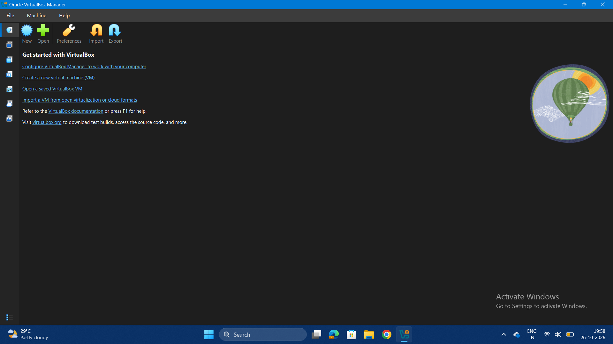
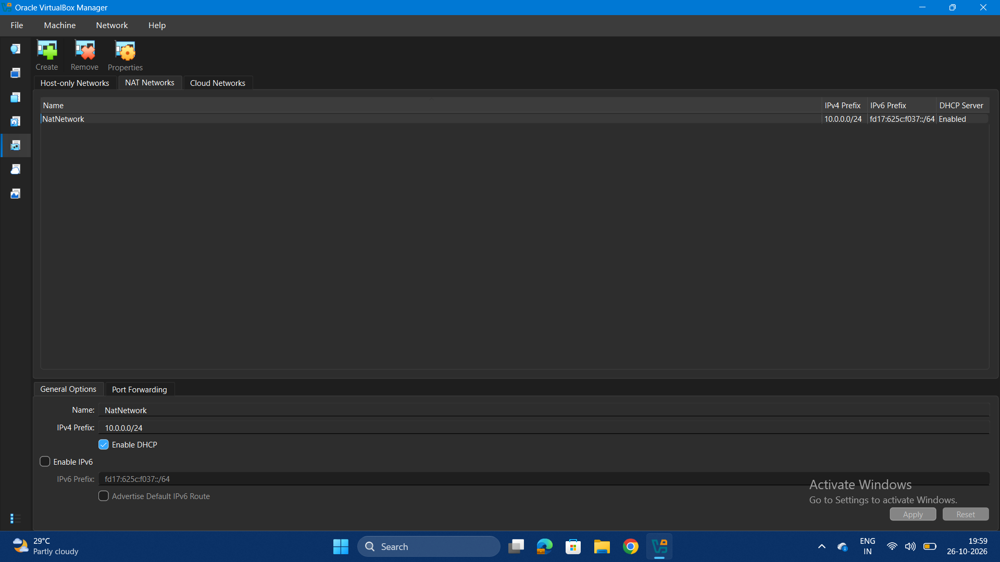
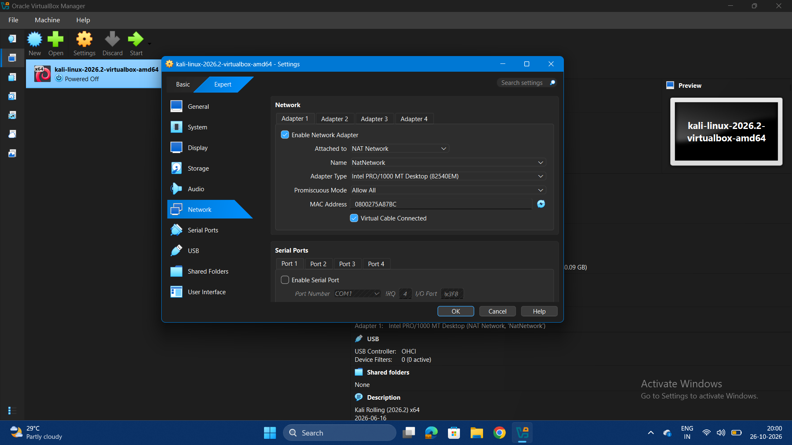
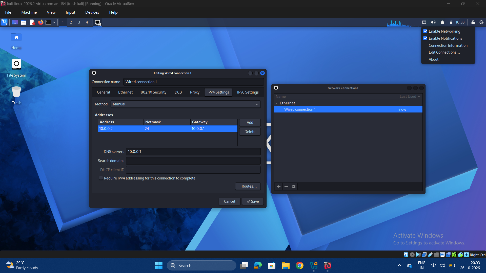
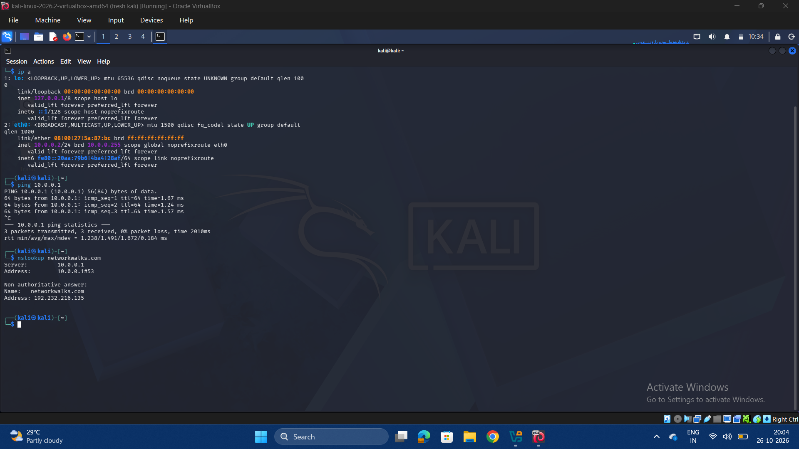

# Cyber Security Lab Setup | Week 1 (Networkwalks Internship)

This repository contain documents of my Week 1 task in the Cyber Security Internship with Networkwalks (B084D). The goal was to build a secure, isolated lab environment for safe security practice.

## What's Covered
- Installing and configuring Oracle VirtualBox
- Creating a NAT network so VMs can communicate with each other and reach the internet without being exposed to the host network
- Installing Kali Linux and configuring its network connectivity
- Taking snapshots to preserve a stable configuration and allow quick recovery

## Key Takeaways
- Why an isolated lab matters for safe security testing
- How NAT networking supports VM-to-VM and internet communication
- How snapshots make it easy to test and restore system states

## Tools Used
VirtualBox, Kali Linux

## Disclaimer
This lab is for educational purposes only. All activities are performed in a controlled, isolated environment.

## Screenshots

### 7Zip Installation

### VirtualBox Installation

### NAT Network Configuration

### Enable Network Adapter

### Kali Linux Network Setup

### Wired Connection Command

### Snapshot

